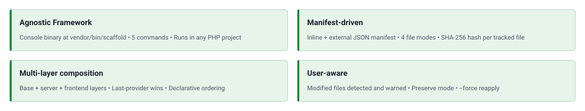

<!-- markdownlint-disable MD041 -->
<p align="center">
    <a href="https://github.com/php-forge/scaffold" target="_blank">
      
    </a>
    <h1 align="center">Scaffold</h1>
    <br>
</p>
<!-- markdownlint-enable MD041 -->

<p align="center">
    <a href="https://github.com/php-forge/scaffold/actions/workflows/build.yml" target="_blank">
        
    </a>
    <a href="https://dashboard.stryker-mutator.io/reports/github.com/php-forge/scaffold/main" target="_blank">
        
    </a>
    <a href="https://github.com/php-forge/scaffold/actions/workflows/static.yml" target="_blank">
        
    </a>
    <a href="https://github.com/php-forge/scaffold/actions/workflows/security.yml" target="_blank">
        
    </a>
</p>

<p align="center">
    <strong>Declarative multi-layer file scaffolding for PHP projects</strong><br>
    <em>Distribute project files through Composer providers and manage them with a standalone Console CLI.</em>
</p>

## Features

<picture>
    <source media="(max-width: 767px)" srcset="./docs/svgs/features-mobile.svg">
    
</picture>

## Installation

```bash
composer config allow-plugins.php-forge/scaffold true
composer require php-forge/scaffold:^0.3
```

Install your scaffold providers, then declare which are permitted to write files into your project:

```json
{
    "extra": {
        "scaffold": {
            "allowed-packages": [
                "php-forge/baseline",
                "php-forge/coding-standard"
            ]
        }
    }
}
```

Run `composer install` to trigger the scaffold process. Commit `scaffold-lock.json` to version control.

To opt out of auto-trigger and manage updates manually via `vendor/bin/scaffold`, set `auto: false` (see
[Configuration Reference](docs/configuration.md#auto)):

```json
{
    "extra": {
        "scaffold": {
            "auto": false,
            "allowed-packages": ["php-forge/baseline", "php-forge/coding-standard"]
        }
    }
}
```

## Configuration

Scaffold configuration for a project with `php-forge/baseline` and `php-forge/coding-standard` already installed:

```json
{
    "require": {
        "php-forge/scaffold": "^0.3"
    },
    "config": {
        "allow-plugins": {
            "php-forge/scaffold": true
        }
    },
    "extra": {
        "scaffold": {
            "allowed-packages": [
                "php-forge/baseline",
                "php-forge/coding-standard"
            ]
        }
    }
}
```

## Console commands

After `composer install`, the plugin ships a standalone Symfony Console CLI at `vendor/bin/scaffold` that works in any
PHP project (Yii2, Yii3, Laravel, Symfony, plain PHP).

| Command                                                            | What it does                                                                                                                                     |
| ------------------------------------------------------------------ | ------------------------------------------------------------------------------------------------------------------------------------------------ |
| `vendor/bin/scaffold status`                                       | Prints a table comparing every tracked file's on-disk hash to the one recorded in `scaffold-lock.json` (`synced` / `modified` / `missing`).      |
| `vendor/bin/scaffold providers`                                    | Lists every provider recorded in `scaffold-lock.json` and how many files each one contributed.                                                   |
| `vendor/bin/scaffold diff <file>`                                  | Shows a line-by-line diff between the provider stub and the current on-disk file.                                                                |
| `vendor/bin/scaffold reapply [file] [--force] [--provider=<name>]` | Re-copies stubs from `vendor/` to the project, updating lock hashes on success. Without `--force`, user-modified files are reported and skipped. |
| `vendor/bin/scaffold eject <file> [--yes]`                         | Removes a file entry from `scaffold-lock.json` without deleting the file from disk. Without `--yes` only previews the change.                    |

Typical post-install workflow:

```bash
vendor/bin/scaffold status                                      # what changed
vendor/bin/scaffold diff config/params.php                      # review one file
vendor/bin/scaffold reapply config/params.php --force           # accept stub version

# or
vendor/bin/scaffold eject config/params.php --yes               # keep yours, stop tracking
```

See [`docs/console.md`](docs/console.md) for the full reference.

## Documentation

- 📚 [Installation Guide](docs/installation.md)
- ⚙️ [Configuration Reference](docs/configuration.md)
- 📦 [Creating Providers](docs/providers.md)
- 🔀 [File Modes](docs/modes.md)
- 🖥️ [Console Commands](docs/console.md)
- 🧪 [Testing Guide](docs/testing.md)

## Package information

[](https://www.php.net/releases/8.3/en.php)
[](https://packagist.org/packages/php-forge/scaffold)
[](https://packagist.org/packages/php-forge/scaffold)

## Project status

[](https://github.com/php-forge/scaffold/actions/workflows/static.yml)
[](https://github.com/php-forge/scaffold/actions/workflows/quality.yml)
[](https://github.styleci.io/repos/1212894073?branch=main)

## Our social networks

[](https://x.com/Terabytesoftw)
[](https://www.facebook.com/wilmer.arambula.9)

## License

[](LICENSE)
